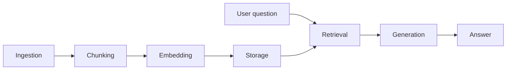

# The Theory of RAG: Teaching the AI New Tricks

A beginner-friendly guide to **Retrieval-Augmented Generation (RAG)**: the problem it solves, how it works, its core concepts, the full pipeline, and an end-to-end example using an Evangadi course chatbot.

> **Big idea:** A normal LLM is very smart, but it only knows what it was trained on and what you put into the current prompt. RAG solves this by searching your own documents first, then giving the most relevant information to the AI **before** it answers.

## Table of Contents

- [1. The Problem: The Isolated Professor](#1-the-problem-the-isolated-professor)
- [2. The Solution: What Is RAG?](#2-the-solution-what-is-rag)
- [3. Core Concepts](#3-core-concepts)
- [4. The RAG Pipeline](#4-the-rag-pipeline)
- [5. End-to-End Example](#5-end-to-end-example)
- [One-Minute Explanation](#one-minute-explanation)
- [Key Terms](#key-terms)
- [Review Questions](#review-questions)

---

## 1. The Problem: The Isolated Professor

An LLM can sound intelligent, but it is not automatically connected to your live company data, private documents, or the latest schedules.

### The analogy

Imagine a brilliant Computer Science professor who understands JavaScript, React, Node.js, APIs, databases, and programming logic. Now lock that professor in a room with no internet, no class schedule, no course calendar, no pricing sheet, no student handbook, and no internal notes.

The professor is still intelligent, but **isolated**. They can answer general programming questions, but cannot reliably answer questions about information they were never given.

> **Teaching point:** an LLM can be excellent at reasoning and language, but still fail because it does not have the correct information available at answer time.

### Limitation 1: Knowledge cutoff

An LLM is trained on data available during its training period. After that, it does not learn new events, schedules, prices, or policy changes unless the information is provided through another system.

- **Question:** "When does the next batch start?"
- **Problem:** the schedule may have been created after the model was trained.
- **Result:** the model may say it does not know, or worse, **guess a believable date**.

The model is not broken. It is frozen with respect to the facts it learned in training.

### Limitation 2: Private data

Most useful company information is private: course prices, internal schedules, student groups, policies, payment rules, and support documents. If the data was not in the training data, the model cannot know it by default.

- **Question:** "How much is the Full Stack class?"
- **Bad behavior:** guesses a generic price from general education costs.
- **Correct behavior:** answers only after checking the official pricing document.

### Limitation 3: Hallucination

A **hallucination** is a confident-sounding answer that is not supported by the actual facts. The model is not lying on purpose; it generates likely text based on patterns it has learned. This is dangerous in company chatbots, where a wrong price, start date, or policy creates confusion and support problems.

| Question | Bad answer | Why it is bad |
|----------|------------|---------------|
| When does Phase 3 start? | "It starts next Monday." | The model guessed instead of checking the official schedule |
| How much is the class? | "Around $5,000." | Uses general knowledge, not company data |
| Can I join late? | "Yes, always." | The real rule may depend on the current cohort policy |

### The old solution: fine-tuning

**Fine-tuning** means training an existing model further on your own examples. In the analogy, it is like sending the professor to orientation to memorize company documents.

It is not the best solution for information that changes often. If the schedule changes every month, retraining monthly is slow, costly, and unnecessary.

| Use fine-tuning for | Use RAG for |
|---------------------|-------------|
| Changing behavior, tone, style, or repeated output format | Changing facts, private documents, schedules, prices, FAQs, and policies |

---

## 2. The Solution: What Is RAG?

**RAG** stands for **Retrieval-Augmented Generation**. It makes an AI answer using external information that is **retrieved at the moment the user asks a question**.

| Part | Meaning | Simple explanation |
|------|---------|--------------------|
| **Retrieval** | Search for relevant information | Find the right page, paragraph, or chunk from your documents |
| **Augmented** | Add that information to the prompt | Give the AI the evidence before asking it to answer |
| **Generation** | Let the LLM write the final response | The AI reads the context and produces a clear answer |

### Give the professor the handbook

Instead of changing the professor's brain, give them the correct page from the student handbook **at the moment the question is asked**.

1. The student asks: "When does the Phase 3 React class start?"
2. The system searches the course calendar.
3. The system retrieves the paragraph with the Phase 3 start date.
4. The system sends both the question and the retrieved paragraph to the LLM.
5. The LLM answers based on that paragraph.

> **Important:** RAG does not require the model to permanently memorize your data. It gives the model the right data **temporarily, inside the current request**.

### Why RAG works

LLMs are very good at reading comprehension. If the answer is placed inside the prompt, the model can usually understand, summarize, and explain it. RAG combines two strengths:

- The **search system** finds the evidence.
- The **LLM** turns evidence into a useful answer.
- The **prompt rules** stop unsupported guessing.

---

## 3. Core Concepts

### Concept A: The context window

The **context window** is the maximum amount of text an LLM can read in one request. It includes the system prompt, user question, retrieved context, previous chat messages, and any instructions.

Even with a large context window, sending too much text is a bad habit: it increases cost, slows the response, and makes it harder for the model to focus on the exact answer.

| Bad idea | Better idea |
|----------|-------------|
| Send a 10,000-page textbook for every question | Search the textbook and send only the few most relevant paragraphs |

RAG depends on **selecting the right context**, not on sending all available text.

### Concept B: Context stuffing

**Context stuffing** means placing the retrieved text directly inside the prompt sent to the LLM. This is the **Augmented** part of RAG.

```
System Prompt:
You are a helpful Evangadi assistant.
Use only the context below to answer the student.

Context:
[PASTE RETRIEVED TEXT HERE]

Student Question:
[PASTE USER QUESTION HERE]
```

This works because the LLM is not asked to remember the answer from training. It is asked to **read the provided context** and answer from it.

### Concept C: Hallucination prevention

**Hallucination prevention** means adding strict rules that stop the AI from guessing when the answer is not in the retrieved context.

```
If the answer is not found in the provided context, say:
"I do not know based on the provided information."
Do not use outside knowledge.
Do not guess.
Do not invent details.
```

This is especially important for business chatbots. If the chatbot should answer only from company documents, it should not answer from general internet knowledge.

---

## 4. The RAG Pipeline

Think of RAG as a **library system for the AI**: first organize the documents, then search the library when a question arrives.

```
Ingestion -> Chunking -> Embedding -> Storage -> Retrieval -> Generation
```



### Step 1: Ingestion (loading the data)

Bring information into the system. Sources can be text files, PDFs, Word documents, website pages, internal manuals, FAQs, or database records.

- **Example file:** `evangadi-info.txt`
- **Goal:** read the text so the application can process it.
- **Good practice:** save **metadata** such as file name, section title, date, and source type. Metadata helps you show where an answer came from or filter results by document type.

### Step 2: Chunking (splitting the text)

Break a large document into smaller pieces. The AI cannot efficiently read every document for every question, and smaller chunks are easier to embed, store, search, and send to the LLM.

| Bad chunking | Good chunking |
|--------------|---------------|
| Cuts a sentence in half | Keeps complete ideas together |
| Creates chunks with no context | Uses **overlap** so meaning continues between chunks |
| Makes chunks too large to search accurately | Uses medium-sized pieces that are specific but meaningful |
| Ignores paragraphs and headings | Uses paragraphs, sentences, and headings as natural boundaries |

**Recursive chunking** tries larger natural boundaries first, then smaller ones only when necessary:

1. Split by large sections or headings.
2. If a section is too large, split by paragraph.
3. If a paragraph is too large, split by sentence.
4. If a sentence is still too large, split by characters.

**Overlap** repeats a small part of the previous chunk in the next one. For example, if the last 50 characters of Chunk 1 are repeated in Chunk 2, the transition between ideas is smoother.

*Why overlap matters:* if one chunk ends with "The Full Stack class price is" and the next starts with "$1000", the meaning is lost unless the chunks overlap or are split better.

### Step 3: Embedding (translating text into meaning vectors)

Each chunk is converted into an **embedding**: a list of numbers that represents the **meaning** of the text.

```
Text chunk:        "The Full Stack class price is $1000."
Embedding vector:  [0.13, -0.44, 0.82, 0.06, ...]
```

> The **same embedding model** must be used for both the stored chunks and the user question, so the system can compare their meanings.

### Step 4: Storage (saving the vectors)

Save the original chunk text and its embedding vector for later search.

| Column | Purpose |
|--------|---------|
| `id` | Unique identifier for the chunk |
| `content` | The actual text of the chunk |
| `embedding` | The vector representation (often stored as JSON in the learning version) |
| `source` | The file or document the chunk came from |
| `metadata` | Optional details such as section, page, topic, or date |

For learning, the course uses **MySQL with a JSON column**. In production, a **vector database** is usually better for large-scale similarity search.

### Step 5: Retrieval (searching by meaning)

When the user asks a question, the system converts it into a vector, compares it with every stored chunk vector, and ranks the chunks by similarity.

Similarity is often calculated with **cosine similarity**. A high score means the question and chunk are close in meaning.

| Chunk | Similarity | Decision |
|-------|-----------|----------|
| Chunk A: "Full Stack class price is $1000." | 0.92 | Use this chunk. Very relevant |
| Chunk B: "React phase starts on Saturday." | 0.63 | Maybe useful, but not about price |
| Chunk C: "Office holiday schedule." | 0.18 | Ignore. Not relevant |

- **Top-k:** select the top few chunks, such as the top 3 most similar.
- **Threshold:** ignore chunks below a minimum score, such as 0.70.

A threshold prevents weak or irrelevant context from confusing the LLM.

### Step 6: Generation (producing the final answer)

Put the retrieved chunks into a prompt, add the user question, and ask the LLM to answer **using only the provided context**.

```
You are a helpful Evangadi Professor.
Use ONLY the context below.
If the answer is not in the context, say "I do not know based on the provided information."

Context:
[Top 3 retrieved chunks]

Question:
[Student question]

Answer:
```

This is where search and language generation work together: **the search system finds evidence, and the LLM explains it.**

---

## 5. End-to-End Example

**User question:** "How much is the Full Stack class?"

### What happens behind the scenes

1. The application receives the student question.
2. The question is converted into an embedding vector.
3. The application compares that vector with the stored document vectors.
4. The top matching chunks are selected.
5. The selected chunks are inserted into the prompt as context.
6. The LLM answers using only that context.

### Retrieved context

```
Chunk 1: The Full Stack Development class costs $1000. Students may contact support for payment options.
Chunk 2: The next Full Stack batch begins on Saturday. Orientation details will be sent by email.
Chunk 3: Students should complete registration before the start of the batch.
```

### Final answer

> The Full Stack Development class costs $1000. For payment options, students should contact support.

The answer is **grounded in the retrieved context**, not a random guess.

### If the answer is not found

**Student:** "Who is the CEO of Apple?"
**Retrieved context:** only Evangadi course information; nothing about Apple's CEO.
**Correct answer:** "I do not know based on the provided information."

This may feel strict, but it is exactly what you want in a controlled company chatbot: it stays inside the knowledge base it was designed to use.

---

## One-Minute Explanation

RAG is like giving an AI an **open-book exam**. The AI may not know a company schedule or price from memory, so the application first searches the company documents, finds the most relevant paragraphs, places them into the prompt, and tells the AI to answer only from those paragraphs. This makes answers more accurate, easier to update, and safer than guessing.

RAG is the bridge between a general AI model and your own reliable knowledge base. It does not make the model magically know everything. It gives the model **the right information at the right time**.

## Key Terms

`RAG` `LLM` `knowledge cutoff` `hallucination` `fine-tuning` `context window` `context stuffing` `ingestion` `chunking` `overlap` `embedding` `vector` `cosine similarity` `top-k` `threshold` `vector database`

## Review Questions

1. Explain the "isolated professor" analogy. What does it say about LLMs?
2. Describe the three limitations of a standard LLM: knowledge cutoff, private data, and hallucination.
3. When should you use fine-tuning, and when should you use RAG?
4. What do the three words in Retrieval-Augmented Generation each mean?
5. Why is sending a 10,000-page textbook with every question a bad idea?
6. What is context stuffing? Write a simple prompt template for it.
7. Why does the strict "I do not know" rule matter for business chatbots?
8. List the six pipeline steps in order and describe each in one sentence.
9. What makes good chunking? Why is overlap useful?
10. Why must the same embedding model be used for chunks and questions?
11. Explain top-k and threshold. Why use a threshold?
12. Walk through what happens when a student asks "How much is the Full Stack class?"

## License

For educational use.