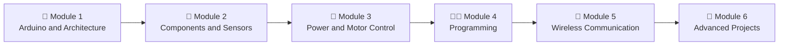

# ⚡ Arduino Engineering Masterclass

### 🔧 From Beginner to Advanced Practical Projects: Electronics, Automation, Wireless Control, RC Airplanes and Drones


> 📘 This repository is my **master study guide and navigation roadmap** for the *Arduino Engineering Masterclass*: 16 chapters covering everything from a blinking LED to a quadcopter flight controller. Every chapter has matching **code**, **circuits** and **projects** so theory is always backed by hardware on the bench.

---

## 📑 Table of Contents

- [🎯 Masterclass Overview](#-masterclass-overview)
- [✅ Course Objectives](#-course-objectives)
- [🗺️ Learning Roadmap](#️-learning-roadmap)
- [📚 Module Breakdown](#-module-breakdown)
- [🧪 Teaching Method (Applied to Every Topic)](#-teaching-method-applied-to-every-topic)
- [🧰 Hardware Toolchain](#-hardware-toolchain)
- [💻 Software Toolchain](#-software-toolchain)
- [📁 Repository Structure](#-repository-structure)
- [🧾 Codes](#-codes)
- [🔌 Circuits](#-circuits)
- [🚀 Projects](#-projects)
- [📈 Progress Tracker](#-progress-tracker)
- [🛡️ Safety First](#️-safety-first)
- [🚦 How to Use This Repository](#-how-to-use-this-repository)
- [🤝 Contributing](#-contributing)
- [📄 License](#-license)

---

## 🎯 Masterclass Overview

The **Arduino Engineering Masterclass** is a practical, project-driven course. It builds knowledge layer by layer: understand the board, learn the components, power and drive real loads, write clean non-blocking firmware, connect wirelessly, and finally integrate everything into **RC airplane** and **drone** systems.

| Item | Details |
|------|---------|
| 🎓 **Level** | Beginner → Advanced |
| 📖 **Chapters** | 16 |
| 🧩 **Main modules** | 6 learning modules (see roadmap) |
| 🔬 **Approach** | Theory → wiring → code → measurement → troubleshooting |
| 🏁 **Capstone** | RC transmitter/receiver and quadcopter flight control |

---

## ✅ Course Objectives

**Course goal:** gain practical engineering knowledge to **design, build, test and troubleshoot** electronics, automation, wireless control, RC airplane and drone projects using Arduino.

By the end of this masterclass I will be able to:

- 🧠 Explain Arduino architecture: the microcontroller, pins, PWM and memory (Flash, SRAM, EEPROM).
- 🔩 Identify, select and test components: resistors, capacitors, diodes, transistors, MOSFETs, regulators and relays.
- 📡 Interface sensors such as ultrasonic (HC-SR04), IR, MPU6050, GPS, and current/voltage sensors.
- 🔋 Design safe power systems with batteries, buck/boost converters, fuses and protection circuits.
- ⚙️ Drive motors using L298N, TB6612FNG, MOSFETs, ESCs and BLDC motors.
- 👨‍💻 Write structured, **non-blocking** firmware using `millis()`, libraries and the Serial Monitor.
- 📶 Build wireless links using Bluetooth, Wi-Fi (ESP8266/ESP32) and nRF24L01.
- ✈️ Design an RC transmitter/receiver with failsafe, and understand quadcopter flight control with PID.
- 🧱 Design PCBs in **KiCad** and document projects professionally.
- 🔎 Troubleshoot hardware and software faults systematically.

---

## 🗺️ Learning Roadmap



| Module | Focus | Chapters |
|:------:|-------|:--------:|
| **1** | 🧠 Understanding Arduino and Architecture | 1, 2 |
| **2** | 🔩 Hardware Components, Sensors and Circuit Practice | 3, 4, 5, 10 |
| **3** | 🔋 Power Supply, Motor Control and Protection | 6, 7, 12 |
| **4** | 👨‍💻 Arduino Programming and Beginner Projects | 8, 13 |
| **5** | 📶 Wireless Communication | 9 |
| **6** | 🚀 Advanced Projects (RC, Drone, KiCad PCB) | 14, 15, 16 |
| ➕ | 🔎 Cross-cutting skill used in every module: Troubleshooting | 11 |

---

## 📚 Module Breakdown

### 🧠 Module 1: Understanding Arduino and Architecture

| Chapter | Title | Key topics |
|:------:|-------|------------|
| **1** | Understanding Arduino and Its Architecture | What is Arduino, microcontrollers, working principle, input/processing/output, digital and analog pins, PWM, memory (Flash, SRAM, EEPROM), programming fundamentals, power basics, beginner mistakes, LED blinking |
| **2** | Arduino Nano Hardware Architecture and Pin Configuration | ATmega328P, D0–D13, A0–A7, PWM pins, TX/RX, SPI, I2C, reset, VIN/5V/3.3V/GND, pin limits, Nano vs Uno, pin identification |

### 🔩 Module 2: Hardware Components and Sensors

| Chapter | Title | Key topics |
|:------:|-------|------------|
| **3** | Electronic Components and Their Functions | Resistors, capacitors, diodes, LEDs, transistors, MOSFETs, voltage regulators, relays, switches, ICs, datasheets, testing |
| **4** | Arduino Input Devices and Sensors | Buttons, potentiometers, LDR, ultrasonic HC-SR04, IR, temperature and humidity sensors, joystick, **MPU6050**, GPS, current/voltage sensors, calibration |
| **5** | Arduino Output Devices | LEDs, buzzers, LCD/OLED displays, relay modules, DC/servo/stepper/**BLDC** motors, solenoid valves, pumps, output protection |
| **10** | Circuit Design, Wiring and Testing | Breadboards, schematics, resistor calculation, multimeter, continuity testing, soldering, PCB fundamentals, inspection |

### 🔋 Module 3: Power Supply and Motor Control

| Chapter | Title | Key topics |
|:------:|-------|------------|
| **6** | Power Supply and Protection Engineering | V/I/R/P, 5V and 3.3V systems, USB and external supplies, Li-ion/LiPo/NiMH, buck/boost converters, decoupling, reverse polarity, short circuit and overcurrent protection, fuses, common ground |
| **7** | Motor Control and Driver Circuits | DC motor principle, transistor and **MOSFET** switching, H-bridge, **L298N**, TB6612FNG, PWM speed control, servos, **ESC**, BLDC control, motor troubleshooting |
| **12** | Electrical Safety and Protection Engineering | Pin voltage/current limits, 3.3V/5V compatibility, flyback diodes, capacitor and fuse selection, grounding, inductive load protection, battery safety, safe testing |

### 👨‍💻 Module 4: Arduino Programming

| Chapter | Title | Key topics |
|:------:|-------|------------|
| **8** | Arduino Programming | IDE, sketch structure, `setup()`/`loop()`, variables, digital/analog I/O, `analogWrite()`, if/else, loops, functions, arrays, Serial Monitor, libraries, **`millis()` and non-blocking code**, debugging |
| **13** | Practical Beginner Projects | LED blink, button control, potentiometer, ultrasonic distance meter, servo, joystick, temperature monitor, automatic lighting, DC motor speed, simple automation |

### 📶 Module 5: Wireless Communication

| Chapter | Title | Key topics |
|:------:|-------|------------|
| **9** | Communication Systems | UART, I2C, SPI, **Bluetooth (HC-05/HC-06)**, **Wi-Fi (ESP8266/ESP32)**, **nRF24L01**, GPS communication, transmitter/receiver systems, range and interference, wireless troubleshooting |

### 🚀 Module 6: Advanced Projects

| Chapter | Title | Key topics |
|:------:|-------|------------|
| **14** | RC Airplane Transmitter and Receiver Project | System architecture, transmitter and receiver design, Nano integration, nRF24L01+ PA/LNA, joystick calibration, 4-channel control, servos, ESC calibration, battery monitoring, **failsafe**, simulator integration, ground and flight testing |
| **15** | Drone Development and Flight Control | Quadcopter architecture, frame, flight controller, IMU, accelerometer and gyroscope, **PID control**, BLDC motors and ESCs, propellers, PDB, LiPo selection, GPS, altitude control, stabilization, failsafe/emergency stop |
| **16** | Advanced Engineering Skills | **PCB design with KiCad**, enclosure CAD, system integration, noise filtering, power budget, reliability, data logging, wireless control, sensor fusion, project documentation |

### 🔎 Cross-Cutting: Troubleshooting

| Chapter | Title | Key topics |
|:------:|-------|------------|
| **11** | Troubleshooting and Common Failures | No power, USB problems, wrong board/port, upload errors, sensor errors, motor not starting, unexpected resets, radio signal loss, noise, overheating, short circuits, software debugging, systematic fault finding |

---

## 🧪 Teaching Method (Applied to Every Topic)

Each topic in the masterclass follows the same 10-step engineering workflow:

1. 📖 Theoretical Explanation
2. 🔍 Component Identification
3. 📄 Datasheet and Pinout Analysis
4. 🔌 Circuit Diagram and Wiring
5. 💻 Programming and Code Explanation
6. 🧪 Practical Experiment
7. 📏 Testing and Measurement
8. 🛠️ Troubleshooting
9. ⚠️ Safety Precautions
10. ❓ Review Questions and Practical Exercises

---

## 🧰 Hardware Toolchain

### 🧠 Controllers
- Arduino **Nano** (ATmega328P), the main board for compact and flight projects
- Arduino **Uno**, the main board for learning and prototyping
- ESP8266 / ESP32 for Wi-Fi projects

### 🔩 Components
- Resistors, capacitors, diodes, LEDs
- Transistors, MOSFETs, relays
- Voltage regulators, buck and boost converters, fuses
- Push buttons, switches, potentiometers, joystick modules

### 📡 Sensors and Modules
- HC-SR04 ultrasonic sensor, IR sensors, LDR
- Temperature and humidity sensors
- **MPU6050** accelerometer and gyroscope
- GPS module
- Current and voltage sensors
- LCD / OLED displays

### ⚙️ Actuators and Drivers
- DC, servo, stepper and **BLDC** motors
- **L298N** and **TB6612FNG** motor drivers
- **ESC** (Electronic Speed Controller)
- Solenoid valves, water pumps, buzzers, relay modules

### 📶 Wireless
- Bluetooth: HC-05 / HC-06
- Wi-Fi: ESP8266 / ESP32
- **nRF24L01+ PA/LNA** for long-range RC links

### 🔋 Power
- USB supply and external DC supplies
- Li-ion, **LiPo** and NiMH batteries, with a power distribution board for drones

### 🧪 Bench Tools
- 🔬 Multimeter (voltage, current, continuity)
- 🔥 Soldering iron and consumables
- 🧱 Breadboard and jumper wires
- 🔌 USB cable and a regulated bench supply (recommended)

---

## 💻 Software Toolchain

| Tool | Purpose |
|------|---------|
| 🟦 **Arduino IDE** | Writing, compiling and uploading sketches; Serial Monitor |
| 📐 **KiCad** | Schematic capture and PCB design |
| 🧊 **CAD software** | Electronics enclosure design |
| 🎮 **RC simulator** | Testing the transmitter before flight |
| 🌿 **Git and GitHub** | Version control and project documentation |

---

## 📁 Repository Structure

```text
Arduino-Engineering-Masterclass/
├── README.md                # 📘 This study guide and roadmap
├── Codes/                   # 💻 Arduino sketches, organized by chapter
│   ├── Ch01_Architecture/
│   ├── Ch08_Programming/
│   └── ...
├── Circuits/                # 🔌 Schematics, wiring diagrams, KiCad files
│   ├── Schematics/
│   ├── Wiring/
│   └── KiCad/
├── Projects/                # 🚀 Complete builds
│   ├── Beginner/
│   ├── RC_Airplane/
│   └── Quadcopter/
└── Docs/                    # 📄 Course outline, datasheets, notes
```

> 💡 Folder names are a suggested layout. Rename them to match your repository and update the links below.

---

## 🧾 Codes

📂 **[Browse the Codes folder →](./Codes)**

All Arduino sketches (`.ino`) live here, grouped by chapter. Each sketch should include:

- 📝 A header comment: purpose, board, pins used and author
- 🔌 A pin-definition block at the top
- 🧱 Clear `setup()` / `loop()` structure, using `millis()` instead of `delay()` where possible
- 💬 Comments explaining *why*, not only *what*

**Suggested naming:** `Ch08_14_millis_blink/Ch08_14_millis_blink.ino`

---

## 🔌 Circuits

📂 **[Browse the Circuits folder →](./Circuits)**

Everything needed to reproduce a build in hardware:

- 🖼️ **Wiring diagrams** (breadboard-style) for each experiment
- 📐 **Schematics** (exported PNG/PDF) following standard symbols
- 🧱 **KiCad projects** (`.kicad_pro`, `.kicad_sch`, `.kicad_pcb`) and Gerber exports
- 📋 **Bill of Materials (BOM)** for each circuit
- 📏 **Measurement notes** (expected voltages and currents)

---

## 🚀 Projects

📂 **[Browse the Projects folder →](./Projects)**

| Level | Project | Chapter | Highlights |
|:-----:|---------|:-------:|------------|
| 🟢 | LED Blinking | 1, 13 | First sketch, circuit and resistor use |
| 🟢 | Push Button LED Control | 13 | Digital input |
| 🟢 | Potentiometer Control | 13 | Analog input and PWM |
| 🟢 | Ultrasonic Distance Meter | 4, 13 | HC-SR04 |
| 🟢 | Servo and Joystick Control | 13 | PWM and analog input |
| 🟡 | Temperature Monitoring and Automatic Lighting | 13 | Sensors and automation |
| 🟡 | DC Motor Speed Control | 7, 13 | MOSFET or L298N with PWM |
| 🔴 | **RC Airplane Transmitter and Receiver** | 14 | nRF24L01+ PA/LNA, 4 channels, servos, ESC, failsafe |
| 🔴 | **Quadcopter Flight Controller** | 15 | MPU6050, PID, BLDC and ESC, failsafe |
| 🔴 | **Custom PCB in KiCad** | 16 | Schematic to PCB, documentation |

Each project folder should contain its own `README.md` with: goal, components, circuit, code, test results, and lessons learned.

---

## 📈 Progress Tracker

Tick each chapter when finished (code, circuit and notes committed).

**Module 1: Architecture**
- [ ] Ch 1: Understanding Arduino and Its Architecture
- [ ] Ch 2: Arduino Nano Hardware Architecture and Pin Configuration

**Module 2: Components and Sensors**
- [ ] Ch 3: Electronic Components and Their Functions
- [ ] Ch 4: Arduino Input Devices and Sensors
- [ ] Ch 5: Arduino Output Devices
- [ ] Ch 10: Circuit Design, Wiring and Testing

**Module 3: Power and Motors**
- [ ] Ch 6: Power Supply and Protection Engineering
- [ ] Ch 7: Motor Control and Driver Circuits
- [ ] Ch 12: Electrical Safety and Protection Engineering

**Module 4: Programming**
- [ ] Ch 8: Arduino Programming
- [ ] Ch 13: Practical Beginner Projects

**Module 5: Wireless**
- [ ] Ch 9: Communication Systems

**Module 6: Advanced Projects**
- [ ] Ch 14: RC Airplane Transmitter and Receiver Project
- [ ] Ch 15: Drone Development and Flight Control
- [ ] Ch 16: Advanced Engineering Skills

**Cross-cutting**
- [ ] Ch 11: Troubleshooting and Common Failures

---

## 🛡️ Safety First

> ⚠️ **Hardware can hurt you and your components.** Follow these rules on every build.

- 🔌 Disconnect power before changing wiring.
- 📏 Respect pin limits: Arduino I/O pins have strict voltage and current limits (see Chapters 2 and 12).
- 🧲 Use **flyback diodes** and drivers (never connect motors or relays directly to a pin).
- 🔋 Handle **LiPo batteries** with care: use a proper charger, never leave them charging unattended, and protect them from shorts and punctures.
- 🧯 Fuse your power lines and check polarity before connecting a battery.
- 🚁 **Remove propellers** during bench testing of drones and RC aircraft.
- 🧪 Test on the ground first, then fly only in safe, open areas and follow local regulations.

---

## 🚦 How to Use This Repository

1. 📥 **Clone** the repository
   ```bash
   git clone https://github.com/<your-username>/Arduino-Engineering-Masterclass.git
   cd Arduino-Engineering-Masterclass
   ```
2. 🟦 Install the **Arduino IDE** and select the correct **Board** and **Port** (Tools menu).
3. 🗺️ Follow the [roadmap](#️-learning-roadmap) in order: Module 1 → Module 6.
4. 🔌 For each chapter: study the notes, build the circuit from `Circuits/`, then upload the sketch from `Codes/`.
5. 📏 Measure, test and troubleshoot, then record your results.
6. ✅ Update the [progress tracker](#-progress-tracker) and commit your work.

---

## 🤝 Contributing

Suggestions, corrections and improvements are welcome.

1. 🍴 Fork the repository
2. 🌿 Create a branch: `git checkout -b feature/my-improvement`
3. 💾 Commit your changes with a clear message
4. 📬 Open a pull request

---

## 📄 License

Add a `LICENSE` file to this repository (for example **MIT**) and update this section with your choice.

---

<p align="center">
  ⚡ <b>Build. Test. Break. Fix. Repeat.</b> ⚡<br>
  <i>Arduino Engineering Masterclass</i>
</p>